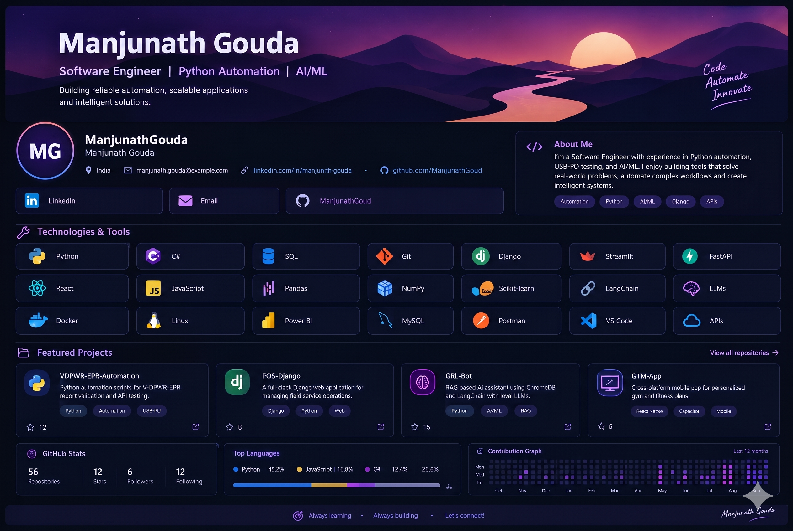

<!--
GitHub Profile README for ManjunathGouda7
-->

<!-- Clickable banner linking to your GitHub profile -->

# Hi, I'm Manjunath Gouda 👋

### Software Engineer · Python Automation · AI/ML

I build reliable automation, practical applications, and intelligent tools that solve real-world problems.

---

## 👨‍💻 About Me

- 🔧 Interested in **software development, test automation, API integration, and validation tools**.
- 🐍 Work with **Python** and automation workflows; also explore C#, SQL, and web development.
- 🤖 Building knowledge and projects in **AI/ML, LLM applications, and retrieval-augmented generation (RAG)**.
- 📊 Interested in turning test results and data into clear, useful reports and dashboards.
- 🌱 Always learning, improving, and building.

## 🛠️ Technologies & Tools

### Languages

### Frameworks & Libraries

### Tools & Areas

## 🚀 Featured Projects

<table>
  <tr>
    <td width="50%">
      <h3>🔌 USBPD-c2-epr-pyclient</h3>
      
GRLPS C2-EPR automation client — drive GRLPS USB-PD C2-EPR application over its local HTTP API and validate compliance metrics.

      
<b>Focus:</b> Python · HTTP API · USB-PD Automation

      <a href="https://github.com/ManjunathGouda7?tab=repositories">View Repositories →</a>
    </td>
    <td width="50%">
      <h3>📊 Django_PBI</h3>
      
Full-stack Python and Django web application integrated with Power BI for data reporting and operational analytics.

      
<b>Focus:</b> Python · Django · Power BI

      <a href="https://github.com/ManjunathGouda7/Django_PBI">View Repository →</a>
    </td>
  </tr>
  <tr>
    <td width="50%">
      <h3>🤖 Chatbot (Local RAG Assistant)</h3>
      
RAG-based AI assistant built in Python using ChromaDB, LangChain, and local LLMs for querying technical documentation.

      
<b>Focus:</b> Python · ChromaDB · LangChain · LLMs

      <a href="https://github.com/ManjunathGouda7?tab=repositories">View Repositories →</a>
    </td>
    <td width="50%">
      <h3>🍽️ Django_Food</h3>
      
Web application built with Django and HTML/CSS for managing food ordering and service workflows.

      
<b>Focus:</b> Django · Python · HTML/CSS

      <a href="https://github.com/ManjunathGouda7/Django_Food">View Repository →</a>
    </td>
  </tr>
</table>

## 📈 GitHub Activity

---

### ✨ Always learning · Always building · Let's connect!

*Thanks for visiting my profile.*

